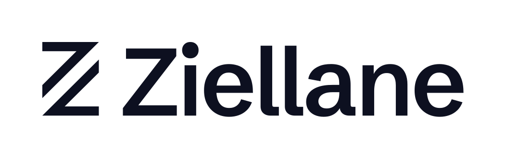

<picture>
  <source media="(prefers-color-scheme: dark)" srcset="lockup-paper.svg">
  
</picture>

### Goals that update themselves.

Ziel means goal. In Ziellane, every goal is a lane that moves forward on its own as the work ships.

Small teams agree on goals at the start of a quarter, and within weeks the tracker is out of date. Ziellane reads the work you already do on GitHub, so nobody has to update anything by hand.

**How it works**

1. **Set a goal.** Each goal is a lane with an owner, a target date and stages from start to finish.
2. **Link the work.** Attach GitHub milestones, labels or issues to the lane.
3. **Watch it move.** The lane moves forward as issues close and pull requests merge. If a goal stalls or its pace slips past the target date, the owner hears about it early.
4. **Confirm the weekly update.** Each owner gets a pre-filled check-in in Slack, adds a sentence of context and posts it to the team.

**Who it's for:** product and engineering teams of about 3 to 20 people whose work lives on GitHub, and open-source maintainers. Public repositories will be free.

**How we treat your code:** read-only GitHub access, no access to the contents of your source code, hosted in the EU.

**Status:** Ziellane is in development. Follow along at [ziellane.com](https://ziellane.com).

---

Questions or early access: hello@ziellane.com
